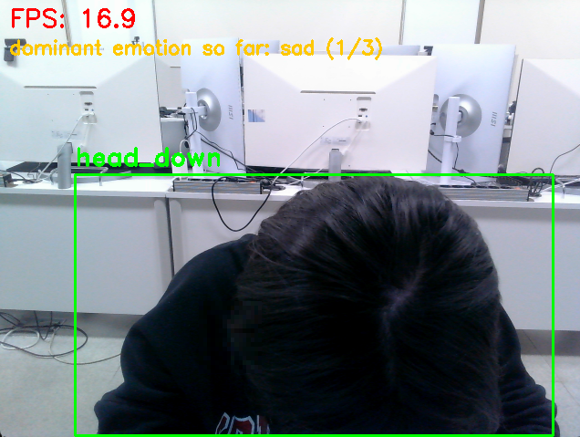
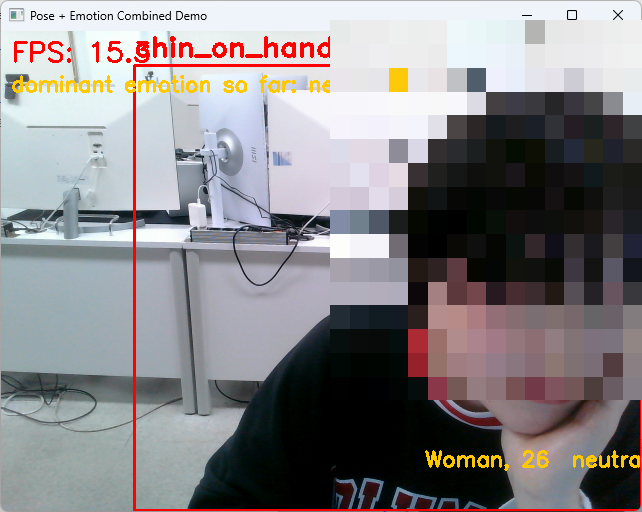
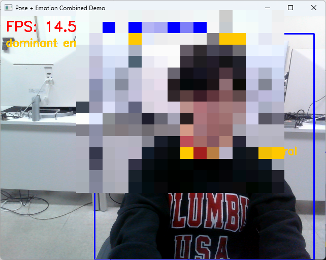
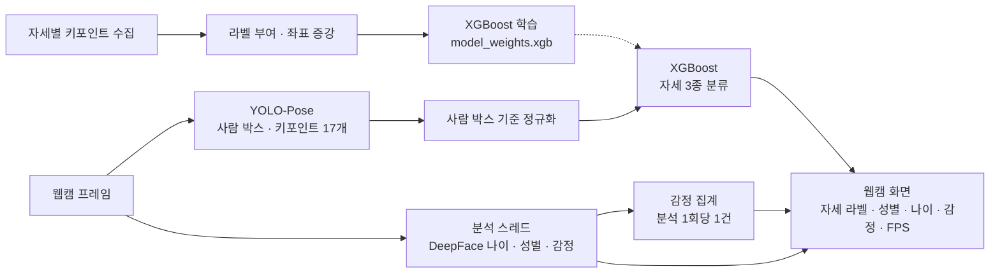

# DeskPoseAI: 책상 앞 자세 분류와 표정 인식

웹캠 한 대로 책상 앞 자세 3종 분류와 표정 인식 결과 집계를 한 화면에 표시하는 실시간 영상 분석 프로젝트.
자세는 YOLO-Pose 키포인트와 XGBoost, 표정은 DeepFace 사용. 사전 학습 모델의 추론 결과를 화면 표시에서 끝내지 않고 분류·집계까지 연결.

| head_down | chin_on_hand | facing_forward |
|---|---|---|
|  |  |  |

*통합 데모 화면. 사람 박스 위 자세 라벨, 얼굴 영역 아래 성별·나이·감정, 화면 상단 FPS와 지금까지 우세 감정. 얼굴 부분은 공개 저장소 게시를 위한 모자이크.*

---

## 개요

| 항목 | 내용 |
|---|---|
| 목적 | 책상 앞 웹캠 한 대로 자세와 표정을 함께 확인, 사전 학습 모델의 추론 결과를 분류·집계까지 연결 |
| 입력 | 책상 위 웹캠 영상, 전신 없이 상반신·얼굴 |
| 자세 | YOLO-Pose `yolo26n-pose.pt` 키포인트 17개 → 사람 박스 기준 정규화 → XGBoost 자세 3종 분류 |
| 표정 | DeepFace 나이·성별·감정 추정, 감정 집계, 얼굴 검출 백엔드 비교 |
| 결과물 | 자세 수집·학습·인식 스크립트, 표정 인식·백엔드 비교 스크립트, 자세·표정 통합 데모 |

*YOLO-Pose: Ultralytics YOLO 계열의 사람 검출·COCO 키포인트 17개 추정 모델. XGBoost: 그래디언트 부스팅 결정 트리 분류 라이브러리. DeepFace: 얼굴 영상에서 나이·성별·감정을 한 번에 추정하는 Python 라이브러리.*

## 기획 과정

| 단계 | 내용 |
|---|---|
| 주제 선정 | 책상 앞 자세 모니터 |
| 입력 조건 | 웹캠이 책상 위에 있는 환경에 맞춰 전신 없이 상반신·얼굴만으로 동작 |
| 선정 이유 | 웹캠 한 대로 자세와 표정을 함께 확인할 수 있는 실용적인 주제라는 판단 |
| 구현 방향 | 사전 학습 모델 YOLO-Pose·DeepFace를 그대로 쓰되, 추론 결과를 표시에서 끝내지 않고 자세 분류·감정 집계까지 연결 |

---

## 전체 구조



| 폴더 | 내용 | 핵심 |
|---|---|---|
| [`pose/`](./pose) | 2D Pose Estimation 기반 행동 인식 | YOLO-Pose로 키포인트 추출 → XGBoost로 자세 3종 분류 |
| [`emotion/`](./emotion) | DeepFace 나이·성별·감정 인식 | 실시간 나이·성별·감정 추출, 감정 집계, 검출 백엔드 비교 |
| [`combined/`](./combined) | 통합 데모 | 자세 라벨과 나이·성별·감정을 한 화면에 동시 표시 |

## 구현 범위

웹캠 화면에 추론 결과를 표시하는 기존 예제 코드 `Emotion_Detection.py`와 2D Pose Estimation 스크립트에 아래 항목 추가.

| 구분 | 추가·변경 |
|---|---|
| 자세 | 포즈 모델 `yolov8n-pose.pt` → `yolo26n-pose.pt` 교체, 책상 앞 자세 3종 데이터 수집과 분류, 키포인트 정규화 기준을 화면 전체에서 사람 박스로 변경, 좌표 증강 `14b_augment_keypoints.py`로 소량의 실촬영 데이터를 학습 가능한 규모로 확장 |
| 표정 | 감정 결과 집계와 우세 감정 판단, `opencv` 고정 검출 백엔드를 `--backend` 인자로 변경하고 비교 스크립트 `compare_backends.py` 추가, DeepFace 분석 스레드 분리로 웹캠 프레임 드랍 해소 |
| 통합 | 자세 인식과 표정 인식을 하나의 웹캠 화면에 동시 표시하는 통합 데모 |

---

## 1. 자세 인식: `pose/`

책상 앞 웹캠 기준 자세 3종 실시간 분류. 전신 없이 상반신·얼굴만 보이는 화면에서 동작.

| 자세 | 뜻 |
|---|---|
| `facing_forward` | 정면 보기 |
| `head_down` | 고개 숙이기 |
| `chin_on_hand` | 턱 괴기 |

자세 목록 기준 파일은 `pose_img/person/classes.json`, 클래스 번호 순서도 이 파일 순서.

### 파이프라인

```
웹캠 프레임
   │
   ▼
YOLO-Pose, yolo26n-pose.pt      →  사람 박스 + 키포인트 17개 x, y 추출
   │
   ▼
사람 박스 기준 정규화           →  x' = (px - box_x1) / box_width, y'도 같은 방식
   │                               카메라 거리·프레이밍과 무관한 일정한 값
   ▼
좌표 증강, 학습 단계만          →  좌우 반전 + 위치·크기 지터 + 노이즈로 샘플 수 확보
   │
   ▼
XGBoost 분류기                  →  자세 3종 중 하나로 분류
   │
   ▼
웹캠 화면에 박스 + 라벨 표시
```

### 스크립트 구성

번호 순서대로 5단계 실행. 모든 파일은 `pose/01_PoseAction/` 아래 위치, 출력 파일은 `pose_img/person/` 아래 저장.

| 단계 | 파일 | 내용 | 출력 |
|---|---|---|---|
| 1 | `12.2D_Pose_Estimation_test.py` | 모델·카메라 확인용 스모크 테스트, 웹캠 프레임에 포즈 추정 결과 표시 | 화면 |
| 2 | `13.2D_Pose_Save.py <자세이름>` | 자세별 웹캠 키포인트·크롭 이미지 수집, 자세마다 실행. 0.5초 간격, 신뢰도 0.75 초과 사람 박스만 저장 | `<자세>/*.jpg`, `keypoints.csv` 이어 쓰기 |
| 2 | `13b_quick_collect.py` | 숫자키로 자세를 바꾸며 한 세션에 수집 | `<자세>/*.jpg`, `keypoints.csv` 이어 쓰기 |
| 2 | `13c_collect_from_images.py` | 이미지 폴더 `pose/raw_images/<자세>/`에서 일괄 수집 | `<자세>/*.jpg`, `keypoints.csv` 새로 쓰기 |
| 3 | `14.2D_Pose_Dataset_Save.py` | 자세 폴더에 있는 이미지 이름 기준 라벨 부여 | `dataset.csv` |
| 3 | `14b_augment_keypoints.py` | 키포인트 좌표 증강 | `dataset_aug.csv` |
| 4 | `15.2D_Pose_Training.py` | XGBoost 학습 | `model_weights.xgb` |
| 5 | `16.2D_Pose_ActionRecognition.py` | 웹캠 실시간 자세 인식 데모 | 화면 |

### 좌표 증강

이미지가 아닌 키포인트 좌표만 증강. XGBoost 입력이 좌표이므로 이미지 추가 수집 없이 학습 샘플 확보.

| 방법 | 내용 |
|---|---|
| 좌우 반전 | `x' = 1 - x`, 좌우 관절 쌍 교환. 거울에 비친 자세도 같은 라벨 |
| 위치·크기 지터 | 관절 중심 기준 ±12% 확대·축소, ±5% 이동. 카메라 거리·위치 차이 모사 |
| 좌표 노이즈 | 표준편차 0.015 가우시안 노이즈. 관절 검출 오차 모사 |

- 기본 배수 `--multiplier 6`: 원본 1행당 원본·반전 2행에 지터 4행 추가
- 저장소의 `dataset.csv` 343행 → `dataset_aug.csv` 2,058행. 원본 자세별 행 수 `facing_forward` 124, `head_down` 101, `chin_on_hand` 118

### 학습과 실시간 인식

- 학습 데이터: `dataset_aug.csv`가 있으면 우선 사용, 없으면 `dataset.csv`
- 입력 특징: 키포인트 17개의 x·y 좌표 34개
- 학습: 8:2 계층 분할, `random_state=42`, 자세 3종 이상이면 `multi:softmax` 다중 분류, 테스트 정확도 콘솔 출력 후 `model_weights.xgb` 저장
- 실시간 인식: 신뢰도 0.75 초과 사람마다 학습 때와 같은 박스 기준 정규화 후 예측, 사람 박스와 자세 라벨 표시

자세한 실행 방법·구현 범위: [pose/README.md](./pose/README.md)

## 2. 표정 인식: `emotion/`

DeepFace `analyze()` 한 번 호출로 `age`, `gender`, `emotion` 추출, 웹캠 화면 실시간 표시와 감정 집계까지 연결.

| 구현 | 내용 |
|---|---|
| 감정 집계 | `collections.Counter`로 감정 등장 횟수 누적 → 화면에 "지금까지 우세 감정" 표시, 종료 시 콘솔에 비율 요약, `results/emotion_log_<backend>.csv` 저장 |
| 검출 백엔드 비교 | `--backend opencv/mtcnn/retinaface/...` 인자, `compare_backends.py`로 여러 실행의 로그를 모아 검출 수·감정 분포·평균 추정 나이 비교 |
| 분석 스레드 분리 | DeepFace 분석 스레드와 화면 표시 루프 분리, 최신 프레임 즉시 표시와 분석 결과 비동기 갱신 |

- 집계 기준: 분석 1회당 1건, 한 화면에 얼굴이 여럿이면 가장 큰 얼굴 1개. 요약 첫 줄의 `총 N회 분석`은 DeepFace 분석 횟수, `얼굴 검출 M회`는 그중 얼굴을 찾은 횟수
- 로그 항목: 경과 시간 `t_sec`, 백엔드, 감정, 나이, 성별. 얼굴 원본 이미지 미저장
- 백엔드 선택지: `opencv`, `mtcnn`, `retinaface`, `ssd`, `dlib`, `mediapipe`, 기본값 `opencv`
- `compare_backends.py`: 백엔드 2개 이상의 로그 필요, 백엔드별 비교표 콘솔 출력, 합친 로그 `results/backend_compare.csv` 저장
- 저장소 포함 로그: `results/emotion_log_opencv.csv`

### 검출 백엔드 특성

| 백엔드 | 속도 | 정확도 | 비고 |
|---|---|---|---|
| `opencv` | 가장 빠름 | 정면은 무난, 측면은 약함 | 설치 불필요, 기본값 |
| `mtcnn` | 느린 편 | 정면·측면 모두 높음 | 랜드마크 포함 |
| `retinaface` | 보통~느림 | 작은 얼굴까지 가장 정확 | GPU 권장 |

### 비교용 스크립트

`01_AgeGender/Age_Gender_Recognition.py`: DeepFace 대신 IMDB-WIKI 가중치 WideResNet으로 나이·성별만 추정하는 비교용 스크립트. 표정 인식과 통합 데모에서 쓰지 않는 참고용 구성.

자세한 실행 방법·구현 범위: [emotion/README.md](./emotion/README.md)

## 3. 통합 데모: `combined/`

자세 인식과 표정 인식을 하나의 웹캠 화면에 합친 데모. 자세 라벨과 나이·성별·감정 동시 표시.

| 구성 | 실행 위치 | 내용 |
|---|---|---|
| 자세 인식 | 메인 루프, 매 프레임 | YOLO-Pose 키포인트 → 사람 박스 기준 정규화 → XGBoost 자세 라벨 |
| 나이·성별·감정 | 분석 스레드 | DeepFace 분석, 메인 루프는 분석 완료를 기다리지 않고 최신 프레임 표시 |
| 감정 집계 | 메인 루프 | 얼굴을 찾은 분석 1회당 1건, 얼굴이 여럿이면 가장 큰 얼굴 기준, `q` 종료 시 콘솔 요약 |

처리 시간이 짧은 자세 인식은 매 프레임, 처리 시간이 긴 DeepFace 분석은 분석 스레드에서 실행해 화면 끊김 방지.

| 화면 위치 | 표시 |
|---|---|
| 사람 박스 위 | 자세 라벨 |
| 얼굴 영역 아래 | `성별, 나이  감정` |
| 화면 상단 | FPS, 지금까지 우세 감정 |

- 얼굴을 찾지 못한 분석에서는 직전 결과를 유지해 화면 글자 깜빡임 방지
- 자세 모델은 `pose/01_PoseAction/pose_img/person/`의 `model_weights.xgb`와 `classes.json` 사용, 가중치 파일이 없으면 `13 → 14 → 14b → 15` 실행 안내 후 종료

자세한 실행 방법: [combined/README.md](./combined/README.md)

---

## 문제 해결

### 1. 키포인트 정규화 기준: 화면 전체 → 사람 박스

| 구분 | 내용 |
|---|---|
| 문제 | 학습 손실은 0에 가까운데 검증 손실은 크게 벌어지는 과적합 |
| 원인 | 화면 전체 기준으로 정규화한 YOLO-Pose 좌표 `xyn` 사용. 사람이 사진·웹캠 속 어디에 얼마나 크게 나오는지에 따라 값이 달라져, 모델이 자세가 아닌 화면 속 위치를 학습 |
| 해결 | 사람 박스 기준 정규화 `x' = (px - box_x1) / box_width`, `y' = (py - box_y1) / box_height`, 0~1 범위로 제한, 검출되지 않은 관절은 0 유지 |
| 결과 | 카메라 거리·프레이밍과 무관하게 일정한 입력값. 수집 `13`·`13b`·`13c`, 예측 `16`, 통합 데모 `combined_demo.py`에 같은 식 적용 |

수집과 예측의 정규화 방식이 어긋나면 예측이 무작위에 가까워지므로 세 단계 모두 같은 식 유지.

### 2. DeepFace 분석 중 웹캠 화면 정지

| 구분 | 내용 |
|---|---|
| 문제 | DeepFace 분석을 메인 루프에서 실행하면 분석하는 동안 웹캠 화면 정지, 프레임 드랍 |
| 원인 | 프레임 표시와 DeepFace 분석을 한 루프에서 순서대로 실행, 분석 시간만큼 다음 프레임 표시 지연 |
| 해결 | DeepFace 분석을 `threading.Thread` 분석 스레드로 분리. 메인 루프는 분석 스레드가 쉬는 동안에만 프레임 복사본 전달, 분석 중이면 전달을 건너뛰고 최신 프레임 즉시 표시. 화면의 분석 결과만 분석이 끝날 때 갱신 |
| 결과 | 웹캠 화면 끊김 해소, 화면 갱신과 DeepFace 분석 시간 분리. `Emotion_Detection.py`, `combined_demo.py`에 같은 구조 적용 |

### 3. 얼굴 여러 개일 때 감정 집계 과다

| 구분 | 내용 |
|---|---|
| 문제 | 한 화면에 얼굴이 여럿이면 감정 집계 횟수가 DeepFace 분석 횟수보다 커짐 |
| 원인 | 화면에 그리는 얼굴마다 매 프레임 직전 감정과 비교해 다르면 1건 추가하는 집계 방식. 얼굴별 감정이 서로 다르면 프레임마다 집계 증가 |
| 해결 | 분석 스레드가 분석을 마칠 때마다 결과를 `deque`에 추가, 메인 루프가 한 번씩만 꺼내 집계. 얼굴이 여럿이면 가장 큰 얼굴 1개 기준 |
| 결과 | 감정 집계 1건이 DeepFace 분석 1회에 대응. `Emotion_Detection.py` 종료 요약에 `총 N회 분석`과 `얼굴 검출 M회` 구분 표시 |

## 한계와 개선 방향

| 설계 선택 | 한계 | 개선 방향 |
|---|---|---|
| DeepFace 얼굴 검출 백엔드 | 조명·각도에 민감, 가장 안정적인 `retinaface`는 GPU 없이 느림 | GPU 환경에서 `retinaface` 사용 |
| 프레임 단위 성별 판정 | 헤어스타일 등 외형에 크게 좌우되어 프레임마다 흔들림 | 최근 N회 다수결로 안정화 |
| 본인 1인 기준 자세 학습 데이터 | 다른 사람에게는 일반화 부족 가능성 | 여러 사람 데이터로 재학습 |
| 단일 프레임 키포인트 분류 | 프레임 간 시간 변화량 미사용, "서는 중" 같은 전이 동작 구분 불가 | LSTM·1D CNN 시퀀스 분류로 확장 |

---

## 실행 방법

```bash
conda activate vision_new
pip install ultralytics opencv-contrib-python pandas xgboost scikit-learn numpy deepface tf-keras
```

- `tf-keras`: TensorFlow 2.16 이상에서 DeepFace가 요구하는 패키지. 설치된 TensorFlow와 같은 버전대로 설치, 예를 들어 TensorFlow 2.21이면 `tf-keras==2.21.*`
- deepface는 의존 패키지로 화면 기능이 빠진 `opencv-contrib-python-headless`도 함께 설치. 이 판이 `cv2`를 덮어쓰면 `cv2.imshow`에서 `The function is not implemented` 오류가 나므로 아래 명령으로 화면 기능이 있는 판 재설치
- `mtcnn`, `retinaface` 백엔드는 `pip install mtcnn`, `pip install retina-face` 추가 설치

```bash
pip uninstall -y opencv-contrib-python-headless
pip install --force-reinstall --no-deps opencv-contrib-python
```

저장소 최상위 폴더 기준 실행 순서.

```bash
cd pose/01_PoseAction
python 12.2D_Pose_Estimation_test.py       # 모델·카메라 확인용 스모크 테스트
python 13.2D_Pose_Save.py facing_forward   # 자세별 웹캠 수집, 자세마다 실행 후 q로 종료
python 13.2D_Pose_Save.py head_down
python 13.2D_Pose_Save.py chin_on_hand
python 14.2D_Pose_Dataset_Save.py          # 라벨 부여 → dataset.csv
python 14b_augment_keypoints.py            # 좌표 증강 → dataset_aug.csv
python 15.2D_Pose_Training.py              # XGBoost 학습 → model_weights.xgb
python 16.2D_Pose_ActionRecognition.py     # 웹캠 실시간 자세 인식

cd ../../emotion
python Emotion_Detection.py --backend opencv   # q로 종료하면 감정 집계 요약 출력
python Emotion_Detection.py --backend mtcnn
python compare_backends.py                     # 백엔드 2개 이상 로그 비교

cd ../combined
python combined_demo.py --backend opencv
```

`classes.json`, `keypoints.csv`, `dataset.csv`, `dataset_aug.csv`, `model_weights.xgb`는 저장소에 포함. 수집·학습 단계 없이 `16`과 통합 데모 실행 가능, `yolo26n-pose.pt`는 첫 실행 때 자동 다운로드.

## 폴더 구성

```
DeskPoseAI/
├── README.md
├── pose/
│   ├── 00_Models/                     # yolo26n-pose.pt, 저장소 제외, 첫 실행 시 자동 다운로드
│   ├── README.md
│   └── 01_PoseAction/
│       ├── 12.2D_Pose_Estimation_test.py
│       ├── 13.2D_Pose_Save.py         # 자세별 웹캠 수집
│       ├── 13b_quick_collect.py       # 숫자키로 자세 전환하며 한 세션에 수집
│       ├── 13c_collect_from_images.py # 이미지 폴더에서 일괄 수집
│       ├── 14.2D_Pose_Dataset_Save.py
│       ├── 14b_augment_keypoints.py   # 좌표 증강
│       ├── 15.2D_Pose_Training.py     # XGBoost 학습
│       ├── 16.2D_Pose_ActionRecognition.py
│       └── pose_img/person/           # classes.json, keypoints.csv, model_weights.xgb 등
├── emotion/
│   ├── README.md
│   ├── Emotion_Detection.py           # 나이·성별·감정 인식, 감정 집계
│   ├── compare_backends.py            # 백엔드 비교
│   ├── 01_AgeGender/Age_Gender_Recognition.py  # 비교용
│   └── results/emotion_log_*.csv
└── combined/
    ├── README.md
    ├── combined_demo.py
    └── docs/demo_*.png
```

저장소 제외 항목, `.gitignore` 기준.

- 모델 가중치 `*.pt`, `*.hdf5`, `00_Models/`: `yolo26n-pose.pt`는 첫 실행 때 자동 다운로드, WideResNet 가중치 `weights.28-3.73.hdf5`는 `emotion/00_Models/`에 배치 후 사용
- 얼굴이 찍힌 개인 웹캠 사진 `pose_img/person/facing_forward|head_down|chin_on_hand/`, `raw_images/`: 공개 저장소라 얼굴 원본은 제외, 코드와 파생 데이터 csv만 공개
- 참고 자료 `*.pptx`, `*.zip`
