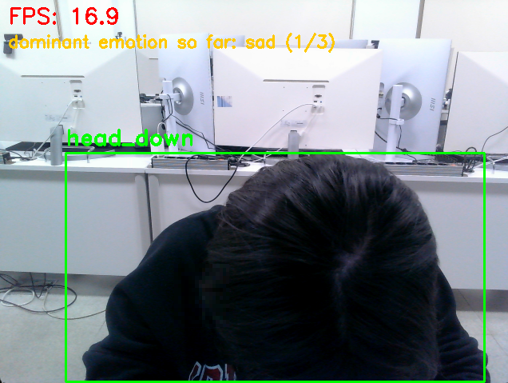
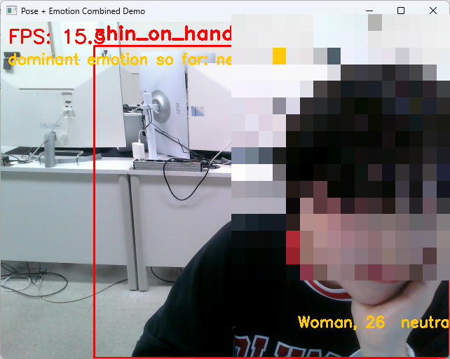
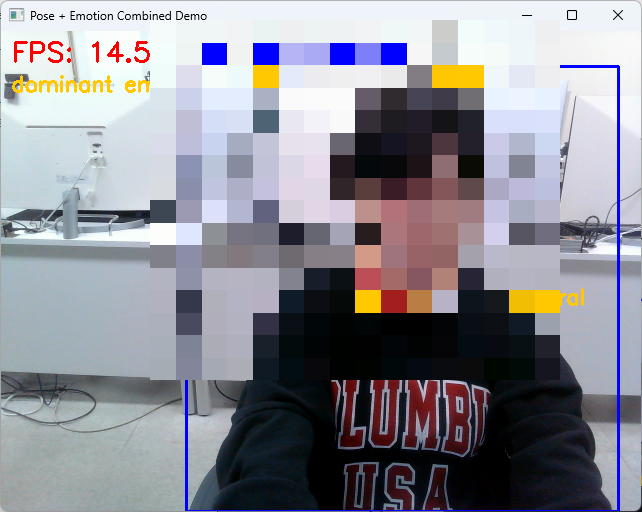

# 자세 + 감정 통합 데모

자세 인식(`pose`)과 나이·성별·감정 인식(`emotion`)을 한 화면에 같이 띄우는 통합 데모.
두 기능은 원래 독립적으로 동작하고, 이를 하나의 웹캠 화면으로 합친 최종 데모.

## 사전 조건

먼저 두 기능이 각각 준비되어 있어야 함:
- `pose/01_PoseAction`에서 `13 → 14 → 14b → 15` 실행 → `model_weights.xgb` 생성됨
- `emotion`은 별도 학습 없음 (DeepFace는 사전학습 모델을 바로 씀)

## 실행

```bash
conda activate vision_new
cd combined
python combined_demo.py --backend opencv
```

- 박스 위: 자세 라벨 (`facing_forward` / `head_down` / `chin_on_hand`)
- 박스 아래: `성별, 나이  감정`
- 화면 상단: FPS, 지금까지 우세 감정
- 자세 인식은 매 프레임 실행(가벼움), 감정 인식은 별도 스레드에서 돌아서(무거움) 화면이 끊기지 않음
- `q`로 종료하면 콘솔에 감정 집계 요약 출력

## 데모 화면

| head_down | chin_on_hand | facing_forward |
|---|---|---|
|  |  |  |

자세 라벨(박스 상단)과 감정/나이/성별(박스 하단)이 동시에 표시되는 것을 확인할 수 있음.
얼굴 부분은 공개 저장소 업로드를 위해 모자이크 처리함.
