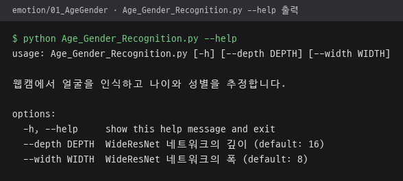

# 01_AgeGender · WideResNet 나이·성별 비교 스크립트

DeepFace 대신 WideResNet 모델로 웹캠 속 얼굴의 나이와 성별만 추정하는 비교용 스크립트. 메인 기능인 DeepFace 나이·성별·감정 인식과는 별개이며 `combined` 데모에서도 쓰지 않는 참고용 구성.

메인 기능 설명은 [emotion README](../README.md), 프로젝트 전체 설명은 [루트 README](../../README.md) 참고.

## 파일

| 파일 | 역할 |
|---|---|
| `Age_Gender_Recognition.py` | Haar Cascade 얼굴 검출, WideResNet 나이·성별 추정, 얼굴 박스·라벨·FPS 화면 표시 |

## 처리 흐름

1. 웹캠 프레임을 0.5배로 축소
2. OpenCV 내장 `haarcascade_frontalface_default.xml`로 얼굴 검출
3. 얼굴 크기의 40% 여백을 더해 잘라 낸 뒤 64×64로 축소
4. 한 프레임의 얼굴을 한 배치로 묶어 WideResNet에 입력
5. 성별 출력 2개 중 여성 확률이 0.5를 넘으면 `Female`, 아니면 `Male` 표시
6. 0~100세 확률 101개에 나이를 곱해 더한 기댓값을 추정 나이로 표시
7. `q` 또는 `Esc` 입력 시 종료

## 실행 방법

```bash
cd emotion/01_AgeGender
python Age_Gender_Recognition.py --depth 16 --width 8
```

- 가중치 파일 `weights.28-3.73.hdf5`를 `emotion/00_Models/`에 두어야 실행 가능. `.gitignore`의 `*.hdf5`, `**/00_Models/` 규칙으로 저장소에서 제외.
- `--depth`, `--width`: WideResNet 깊이와 폭, 기본값 16과 8.
- `tensorflow`, `keras` 사용. GPU가 있으면 메모리를 필요한 만큼만 잡도록 설정.
- 영상 파일 입력 줄은 주석 처리 상태라 기본 웹캠만 사용.

`--help`로 실행한 인자 설명 출력. TensorFlow 2.21, Keras 3.15 환경.



가중치 파일 `weights.28-3.73.hdf5`가 없는 환경이라 웹캠 실행 화면은 미첨부. 가중치 없이 실행하면 WideResNet 모델 구성까지 진행한 뒤 가중치 파일 확인 단계의 `FileNotFoundError`로 종료.
