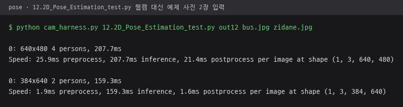
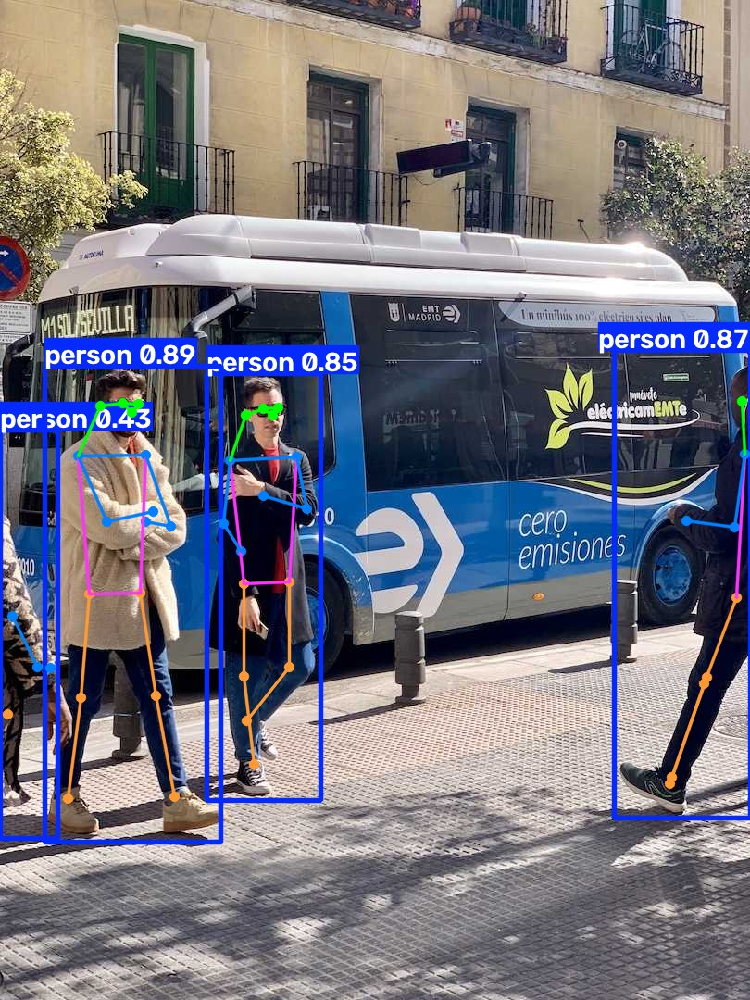
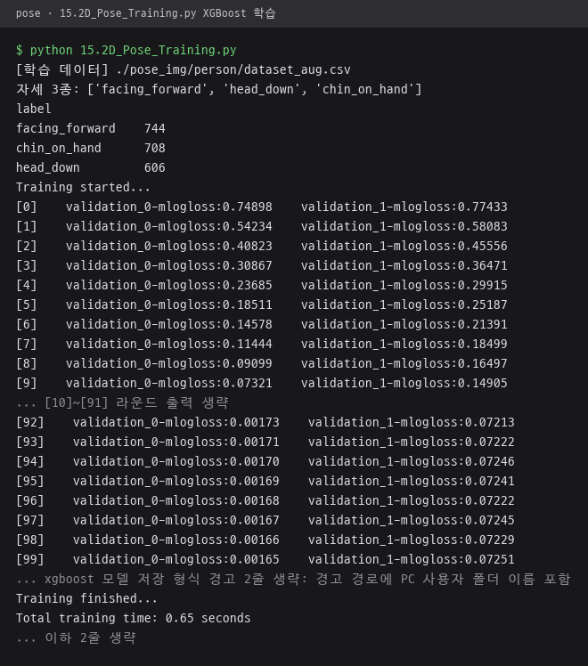
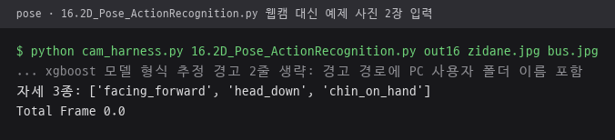
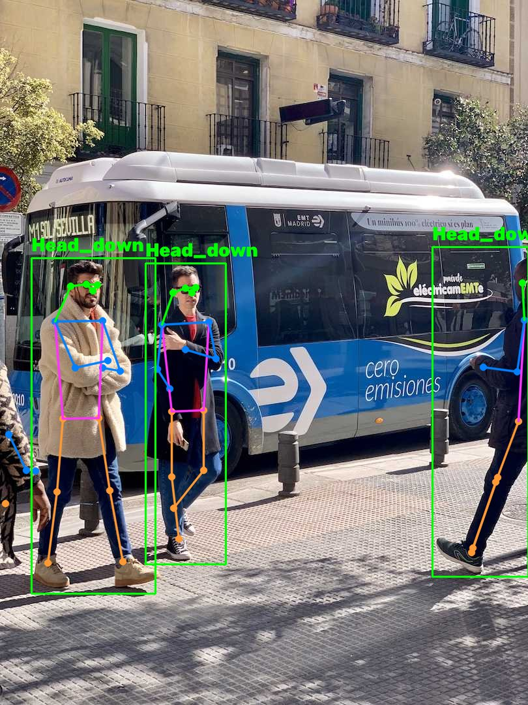

# 01_PoseAction · 자세 수집·학습·인식 스크립트

YOLO-Pose 키포인트 수집부터 XGBoost 학습, 웹캠 실시간 자세 분류까지 번호 순서로 이어지는 스크립트 폴더. 박스 기준 정규화와 좌표 증강 설명, 전체 실행 순서는 [pose README](../README.md), 프로젝트 전체 설명은 [루트 README](../../README.md) 참고.

## 스크립트

| 파일 | 역할 | 입력 → 출력 |
|---|---|---|
| `12.2D_Pose_Estimation_test.py` | 웹캠 프레임에 YOLO-Pose 추정 결과만 그려 모델·카메라 동작 확인 | 웹캠 → 화면 |
| `13.2D_Pose_Save.py` | 인자로 받은 자세 하나를 0.5초 간격으로 수집. 신뢰도 0.75 초과 사람 박스를 잘라 저장하고 박스 기준 정규화 키포인트 기록 | 웹캠 → `<자세>/*.jpg`, `keypoints.csv` 이어 쓰기 |
| `13b_quick_collect.py` | 숫자키로 자세를 바꾸며 한 세션에서 0.15초 간격 자동 수집 | 웹캠 → `<자세>/*.jpg`, `keypoints.csv` 이어 쓰기 |
| `13c_collect_from_images.py` | 자세별 이미지 폴더에서 가장 큰 사람 박스 하나만 골라 키포인트 추출 | `../raw_images/<자세>/` → `<자세>/*.jpg`, `keypoints.csv` 새로 쓰기 |
| `14.2D_Pose_Dataset_Save.py` | 자세 폴더에 남아 있는 이미지 이름으로 라벨 부여, 어느 폴더에도 없는 행 제거 | `keypoints.csv` → `dataset.csv` |
| `14b_augment_keypoints.py` | 좌우 반전, 위치·크기 지터, 좌표 노이즈로 키포인트 증강. 기본 6배 | `dataset.csv` → `dataset_aug.csv` |
| `15.2D_Pose_Training.py` | 8:2 분할 후 XGBoost 분류기 학습, 테스트 정확도 출력. `dataset_aug.csv`가 있으면 우선 사용 | `dataset_aug.csv` → `model_weights.xgb` |
| `16.2D_Pose_ActionRecognition.py` | 프레임마다 키포인트를 같은 방식으로 정규화해 자세 예측, 사람 박스와 자세 라벨 표시 | 웹캠, `model_weights.xgb` → 화면 |

출력 경로의 `<자세>/`, `keypoints.csv` 등은 모두 `pose_img/person/` 아래 위치.

## 실행 결과

저장소 사본에서 실행한 결과. 웹캠을 쓰는 `12`, `16`은 카메라 입력을 ultralytics 예제 사진 `bus.jpg`, `zidane.jpg`로 바꾸는 실행 도구 `cam_harness.py`로 스크립트 소스 수정 없이 실행. `cam_harness.py`는 캡처용으로만 쓴 도구라 저장소에 넣지 않음. 실존 인물이 찍힌 `zidane.jpg`의 결과 화면은 싣지 않고 `bus.jpg` 결과만 첨부. 자세별 크롭 이미지 폴더가 저장소에 없어 `13`, `13b`, `13c`, `14`는 실행 결과 미첨부.

`12.2D_Pose_Estimation_test.py` 실행 결과. 사진마다 YOLO-Pose 추론 결과 한 줄씩 콘솔 출력, 화면에는 박스와 키포인트 표시.

`15.2D_Pose_Training.py` 실행 결과. 저장소의 `dataset_aug.csv` 2,058행으로 100라운드 학습, 다시 만든 `model_weights.xgb`가 저장소 파일과 같은 내용. 좌표 증강 실행 결과는 [pose README](../README.md#데이터-증강) 참고.

`16.2D_Pose_ActionRecognition.py` 실행 결과. 콘솔에는 자세 목록과 카메라 총 프레임 수 출력. 총 프레임 수 0.0은 사진을 넣은 실행 도구가 돌려준 값.

`bus.jpg` · 전신 3명 `head_down`

박스 위 라벨은 `pose_classes[pred].capitalize()` 표기, 색은 자세 번호 순서의 `POSE_COLORS`. 책상 앞 자세 사진이 아니므로 라벨은 학습 범위 밖 입력에 대한 결과.

## pose_img/person 폴더

수집 데이터와 학습 결과를 모으는 데이터 폴더.

| 파일 | 내용 |
|---|---|
| `classes.json` | 자세 목록 `facing_forward`, `head_down`, `chin_on_hand`. 직접 관리하는 기준 파일이며 클래스 번호 순서도 이 순서 |
| `keypoints.csv` | 이미지 이름, 라벨, 키포인트 17개의 `x0`~`y16` 좌표 |
| `dataset.csv` | 라벨을 다시 붙여 정리한 학습용 원본 |
| `dataset_aug.csv` | 증강 결과. 이미지 이름 뒤에 `#orig`, `#flip`, `#orig_jit0` 같은 태그 부착 |
| `model_weights.xgb` | 학습된 XGBoost 모델 |

자세별 크롭 이미지 폴더 `facing_forward/`, `head_down/`, `chin_on_hand/`와 `raw_images/`는 얼굴이 찍힌 사진이라 `.gitignore`로 저장소에서 제외.

## 실행 시 참고

- 모든 스크립트가 시작 시 작업 경로를 이 폴더로 바꾸므로 어느 위치에서 실행해도 같은 상대 경로 사용.
- YOLO-Pose 모델 경로는 `../00_Models/yolo26n-pose.pt`.
- `13`, `13b`는 기존 `keypoints.csv`에 이어 쓰고, `13c`는 실행할 때마다 덮어씀.
